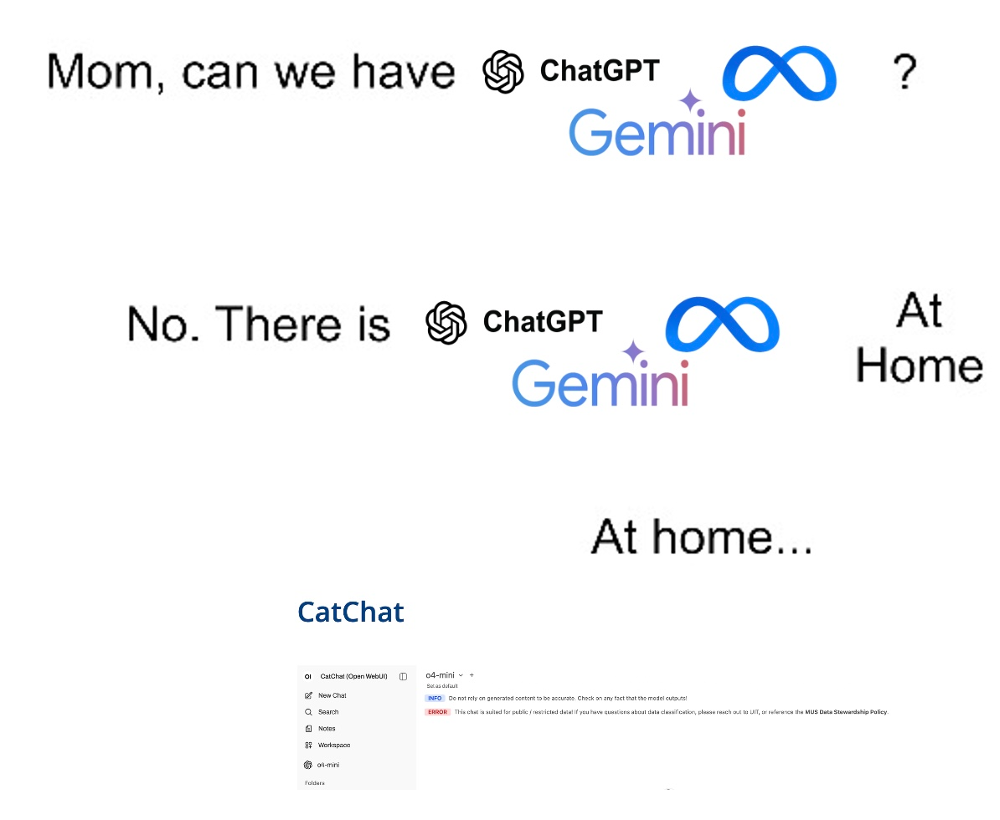
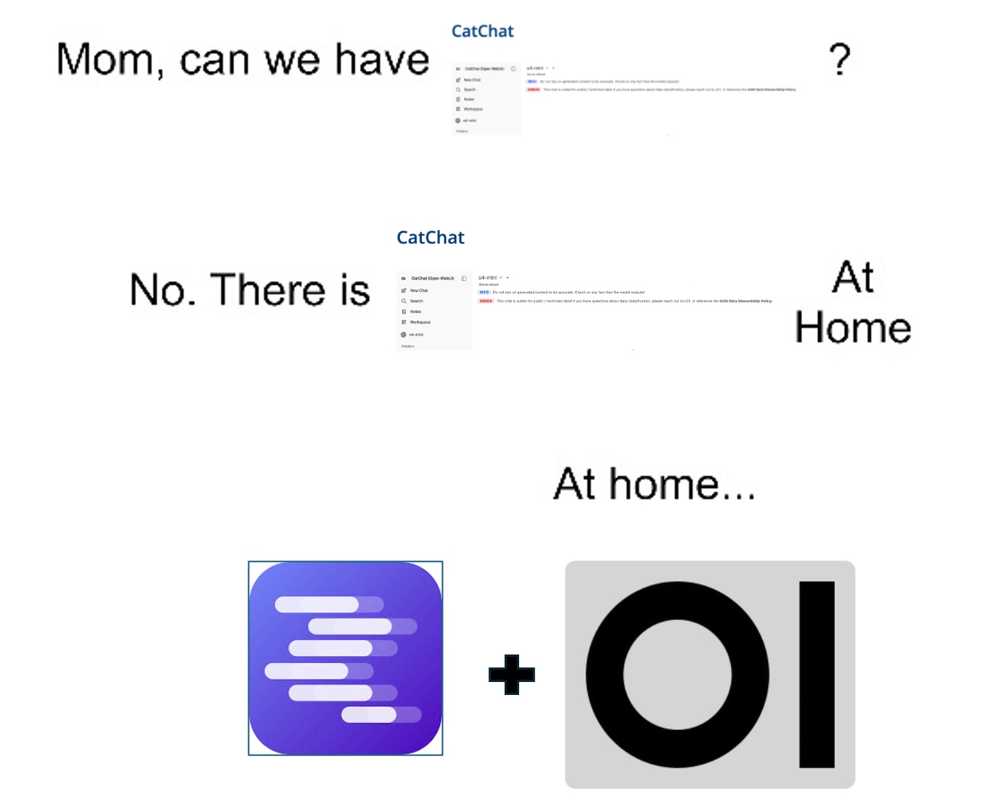

# 

[efolsom17.github.io](https://efolsom17.github.io/)

# 

#

## Why Local AI Models? {.incremental}

::: column
**Privacy and Security**

::: {.incremental}

-  Data never leaves your machine.
  
:::

:::

::: column

**Cost Control**

::: {.incremental}

-  No per-token API fees once hardware is set up.
  
:::

:::

::: column

**Control and Customization**

::: {.incremental}
-  Full control over parameters (temp, context).
  
:::

:::

::: column

**Offline Capability**

::: {.incremental}

-  Run models without internet connection.
  
:::

:::

## Limitations and Hardware Requirements

### Interpreting Specs
   -  **Model Size (e.g., 7B, 70B):** Determines capability; more parameters = more power, but more memory.
   -  **Quantization (Q4_K_M, GGUF):** Model compression. Smaller file size, less memory usage, slight accuracy trade-off.
   -  **Memory Estimates:** A 7B Q4 model needs ~4-5 GB of VRAM/RAM.

### Hardware Check
  -  **Ideal:** Dedicated GPU with sufficient VRAM.
  -  **Alternative:** Strong multi-core CPU and ample system RAM.

## Some Local Model Options and Resources

::: column

**Tools**

  - **LM Studio:** All-in-one GUI
  - **Ollama:** CLI tool and GUI
  - **Llama.cpp:** Highly optimized library
  - **OpenWebUI/Frontends:** Web UIs consuming the local API.

:::

::: column

**Source**

  **Hugging Face:** Primary repository for models.

:::

## Local vs. Frontier Models (GPT/Claude Comparison)

### When to Choose Which

::: column
**Choose Local**

::: {.incremental}
   - Privacy Paramount
   - Offline Necessity
   - Narrow/Internal Tasks

:::

:::

::: column
**Choose Frontier**

::: {.incremental}
  - Cutting Edge Reasoning
  - Massive Knowledge Base
  - Complex "Creative" Generation

:::
:::

## Guide 

[efolsom17.github.io](https://efolsom17.github.io/)